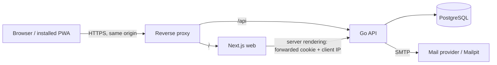
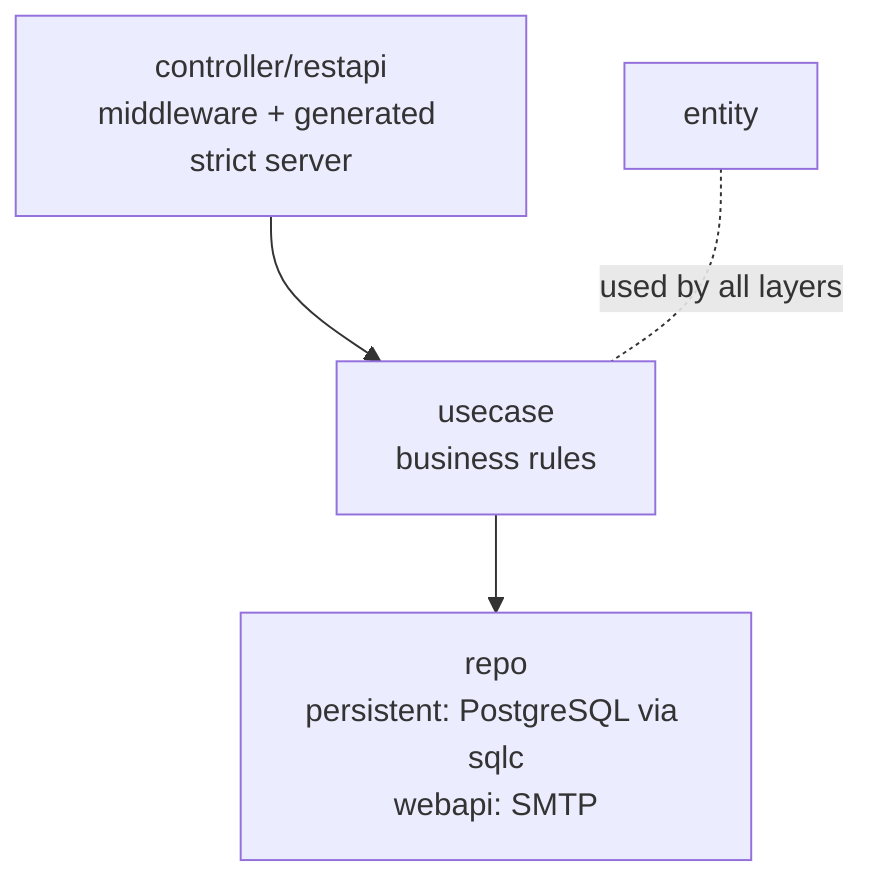

# Architecture

## System



- The browser only talks to one origin. `/api` goes to the Go API, everything else to Next.js, so the session cookie is first-party.
- Next.js renders pages. For data a layout needs (who is signed in, their membership) it calls the API on the server, forwarding the session cookie and the client IP. Lists and writes go from the browser to `/api`.
- The Go API owns every business rule and authorization decision ([ADR 0018](decisions/0018-nextjs-app-router.md)).

## Contract

`openapi/openapi.yaml` defines every endpoint. Go server interfaces and TypeScript types are generated from it; CI fails when generated code is out of date or a change breaks the contract ([ADR 0005](decisions/0005-spec-first-openapi.md)).

## API layers



- Dependencies point inward through interfaces in `contracts.go`; `depguard` enforces this ([ADR 0003](decisions/0003-clean-architecture-layout.md)).
- `internal/app` wires everything with constructors and runs the HTTP server and the email outbox worker.

## Request flow (organization data)

1. Middleware resolves the session from the `__Host-session` cookie ([ADR 0006](decisions/0006-server-side-sessions.md)) and rejects cross-origin writes ([ADR 0015](decisions/0015-csrf-origin-checks.md)).
2. For `/orgs/{slug}/...`, the use case checks the caller's active membership and role.
3. The repository opens a transaction as the `app` database role and runs `SET LOCAL app.user_id` and `SET LOCAL app.org_id`; row-level security limits every query to that organization ([ADR 0008](decisions/0008-row-level-security.md)).
4. Emails caused by the change are written to the outbox in the same transaction and sent after commit ([ADR 0010](decisions/0010-email-outbox.md)).
5. Errors are returned as RFC 9457 problem details.

## Tenancy

Users are global; organizations own data; memberships carry the role (`owner`, `admin`, `member`) and status. The active organization comes from the URL `/o/{slug}`. Sign-in history belongs to the user ([ADR 0007](decisions/0007-multi-org-tenancy.md)).

## Repository layout

Summary below; every folder and file is described in [project-structure.md](project-structure.md).

```
openapi/    contract
api/        Go module (cmd/app, config, internal/{app,controller,entity,usecase,repo}, pkg, migrations, queries)
web/        Next.js app
e2e/        Playwright tests on the full stack
deploy/     production compose and proxy config
docs/       this documentation
.claude/    agent rules, roles, skills and hooks
.github/    CI, Claude workflows, issue and PR templates
```
